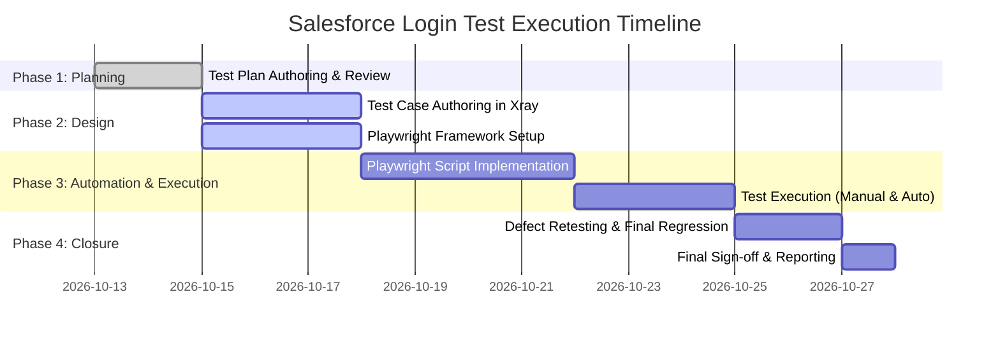

# Master Test Plan — Salesforce CRM Login & Authentication Module

**Document Identifier**: `TP-SFDC-LOGIN-001`  
**Version**: 1.0  
**Status**: Approved Draft  
**Target System**: Salesforce CRM (`https://login.salesforce.com/?locale=in`)  
**Standard**: Aligned with ISO/IEC/IEEE 29119-3 & RICE POT QA Framework (Profile B)  
**Creation Date**: 2026-10-13  
**Authors**: Senior QA Lead / Test Strategist  

---

## 1. Test Plan ID and Title

* **Test Plan ID**: `TP-SFDC-LOGIN-001`
* **Test Plan Title**: Salesforce CRM Login and Authentication Module Master Test Plan
* **System Under Test**: Salesforce CRM Web Application
* **Module / Feature**: User Authentication, Login Page UI, Session Initialization
* **Target Audience**: QA Engineers, Automation Engineers, Development Team, Product Owners, and DevOps Engineers

---

## 2. Objective and References

### 2.1 Business & Quality Objectives
The primary objective of this test plan is to establish a rigorous, repeatable testing strategy for the Salesforce CRM authentication entry point. This includes:
1. Validating that legitimate users experience frictionless, secure access to the Salesforce platform.
2. Ensuring unauthorized access attempts, malformed inputs, and security edge cases are correctly rejected without compromising system integrity.
3. Guaranteeing UI consistency, accessibility, and functional parity across modern desktop browsers.
4. Delivering a production-grade automated regression suite built on **Playwright (TypeScript)** integrated into CI/CD pipelines.
5. Providing full transparency and traceability via **Jira + Xray**.

### 2.2 References
* **PRD-SFDC-AUTH-001**: Salesforce Identity and Access Management Specification
* **SRS-SFDC-UI-002**: Login Page UI/UX and Layout Design Requirements
* **SEC-POL-004**: Enterprise Authentication, Password Policy, and Credential Masking Guidelines
* **RICE POT Framework**: [04_RICE_POT_Generic_QA_Template.md](file:///g:/New%20folder/TTA_26/LearnJSTSPlaywright4x/00_chapter_Prompt_Eng/TestPlan/04_RICE_POT_Generic_QA_Template.md)
* **Playwright Standards**: Official Playwright Documentation (v1.44+) & POM Architecture

---

## 3. In Scope and Out of Scope

### 3.1 In Scope
* **Functional Authentication**:
  * Positive login with active, valid credentials across assigned user profiles (Standard User, System Administrator).
  * Negative authentication scenarios: incorrect password, unregistered username, case sensitivity verification.
  * Validation rules: blank username, blank password, both fields blank, whitespace trimming.
  * Edge cases: SQL-like strings, script tags, long string inputs (255+ characters) to verify input sanitization.
* **UI & UX Controls**:
  * "Remember Me" checkbox behavior across browser restart and reload cycles.
  * Password masking (`type="password"`) and absence of plaintext exposure.
  * Field tab order, default cursor focus, and keyboard submission via the `Enter` key.
* **Secondary Navigation**:
  * "Forgot Your Password?" link navigation and landing page verification.
  * "Use Custom Domain" link navigation and URL structure redirection.
* **Cross-Browser Parity**:
  * Chromium (Google Chrome), Firefox, and WebKit (Safari engine) on desktop resolutions (1920x1080, 1366x768).
* **Test Automation**:
  * Automated smoke and regression suites developed using Playwright with TypeScript and Page Object Model (POM).

### 3.2 Out of Scope
* Multi-Factor Authentication (MFA) hardware security keys (e.g., YubiKey) and authenticator push notifications (covered under separate test plan `TP-SFDC-MFA-002`).
* Single Sign-On (SSO) SAML/OAuth backend identity provider configurations (e.g., Okta, PingIdentity, Azure AD).
* Core post-login business domain features (Sales Cloud, Service Cloud, Lead management).
* Deep infrastructure-level penetration testing (DDoS, packet sniffing, OS-level vulnerabilities).
* Performance load testing exceeding 10,000 concurrent sessions (handled by dedicated Performance Team).

---

## 4. Requirements and Planned Coverage

### 4.1 Requirement Traceability Matrix (RTM)

| Requirement ID | Requirement Description | Risk Level | Planned Test Types | Automation Candidate | Traceable Test IDs |
| :--- | :--- | :--- | :--- | :--- | :--- |
| **REQ-01** | An active account with valid credentials authenticates successfully and redirects to the Salesforce home dashboard / landing page. | Critical (High) | Functional Positive, Smoke, E2E | Yes (P1) | `TC-SFDC-001`, `TC-SFDC-002` |
| **REQ-02** | An incorrect password or non-existent username prevents authentication and presents a generic error message: *"Please check your username and password."* | High | Functional Negative, Security | Yes (P1) | `TC-SFDC-003`, `TC-SFDC-004` |
| **REQ-03** | Submitting empty mandatory fields (username, password, or both) halts submission and renders inline validation warnings without sending network auth payloads. | Medium | Client-side Validation, Negative | Yes (P2) | `TC-SFDC-005`, `TC-SFDC-006` |
| **REQ-04** | Checking "Remember Me" persists the username in the input field across browser reloads, while strictly leaving the password field empty. | Medium | State Persistence, Functional | Yes (P2) | `TC-SFDC-007` |
| **REQ-05** | Password input is visually masked (`type="password"`) and does not expose plaintext credentials in the DOM, browser history, or URL query parameters. | High | Security, Privacy, UI | Yes (P1) | `TC-SFDC-008` |
| **REQ-06** | The login interface renders consistently and executes identically across Chromium, Firefox, and WebKit. | High | Cross-Browser, Compatibility | Yes (P1) | `TC-SFDC-009` |
| **REQ-07** | "Forgot Your Password?" and "Use Custom Domain" links navigate to correct respective sub-pages without broken links. | Low | Functional, Navigation | Yes (P3) | `TC-SFDC-010`, `TC-SFDC-011` |
| **REQ-08** | Repeated failed login attempts (>= 5 attempts) trigger rate limiting / temporary account protection warning message. | High | Security, Negative | Semi-automated (P2) | `TC-SFDC-012` |

---

## 5. Test Approach, Levels, and Types

### 5.1 Test Levels
1. **Component / UI Level**: Verify static visual elements, input attributes, ARIA tags, button states, and CSS layout integrity.
2. **System Integration Level**: Verify client-server authentication handshakes, HTTP response status codes (`200 OK`, `302 Redirect`, `401 Unauthorized`), and authentication session cookie creation.
3. **End-to-End (E2E) Regression Level**: Full lifecycle verification from page load, credential entry, submission, to target page readiness.

### 5.2 Test Types & Methodologies
* **Smoke Testing**: 3 high-priority automated tests executed on every build/deployment to verify login availability.
* **Positive & Negative Functional Testing**: Comprehensive boundary and error condition verification.
* **Cross-Browser Testing**: Playwright multi-project test executions executing headless and headed across Chromium, Firefox, and WebKit.
* **Usability & Accessibility Testing**:
  * Keyboard navigation testing: `Tab`, `Shift+Tab`, and `Enter` key behavior.
  * Screen reader compatibility: verify `aria-label`, placeholder attributes, and readable error alerts.

### 5.3 Automation Strategy
* **Framework**: Playwright with TypeScript.
* **Pattern**: Page Object Model (POM) separating UI locators and page actions from test assertions.
* **Locators Strategy**: Prioritize stable resilient user-facing locators (`page.getByLabel()`, `page.getByRole()`, `page.locator('#username')`) over brittle absolute XPaths.
* **Assertions**: Asynchronous auto-retrying assertions (`await expect(locator).toBeVisible()`).
* **CI/CD Integration**: Headless parallel test execution triggered via GitHub Actions on Pull Requests and nightly schedules.

---

## 6. Environment, Tools, Access, and Test Data

### 6.1 Environment Topology
* **Target URLs**:
  * QA / Development Sandbox: `https://test.salesforce.com` (or dedicated developer scratch org)
  * Production Baseline: `https://login.salesforce.com/?locale=in`
* **Network & Security**: Ensure QA runner IPs are whitelisted in Salesforce Network Access settings to prevent CAPTCHA/bot challenges during test runs.

### 6.2 Tooling Stack

| Tool Category | Tool / Library | Version / Specification | Purpose |
| :--- | :--- | :--- | :--- |
| **Test Automation** | Playwright | `^1.44.0` | E2E browser automation & cross-browser engine |
| **Language & Runtime** | Node.js / TypeScript | Node v20 LTS / TS v5.x | Execution runtime and strongly typed test scripts |
| **Test Management** | Jira + Xray Plugin | Cloud / Server | Test case authoring, execution tracking, traceability |
| **Version Control** | Git / GitHub | Main branch protected | Code repository for Playwright automation framework |
| **CI/CD Pipeline** | GitHub Actions | Ubuntu / Windows runners | Automated smoke & regression execution on push/cron |
| **Reporting** | Playwright HTML / Allure | Native / Allure v2 | Interactive test reports with traces, screenshots, videos |

### 6.3 Test Data & Provisioning

| Account Persona | Description | Username Format | Security Role |
| :--- | :--- | :--- | :--- |
| **Standard Active User** | Verified active user account | `qa.standard.user@example.test` | Standard Salesforce Platform User |
| **Admin Active User** | Verified administrator account | `qa.admin.user@example.test` | System Administrator |
| **Locked / Inactive User** | Inactive or locked user | `qa.locked.user@example.test` | Login Access Disabled |
| **Invalid Credentials** | Synthetic non-existent data | `invalid.user.999@test.invalid` | Non-existent |

> [!IMPORTANT]
> **Secret Handling Rule**: Passwords and sensitive credentials must **never** be hardcoded in repository code or test files. All credentials must be injected at runtime via environment variables (e.g., `SFDC_TEST_USERNAME`, `SFDC_TEST_PASSWORD`) managed through secure CI/CD secrets.

---

## 7. Entry and Exit Criteria

### 7.1 Entry Criteria (Prerequisites to start execution)
* [ ] Test Plan approved by QA Lead and Product Owner.
* [ ] QA Sandbox environment online, accessible, and verified healthy (HTTP 200).
* [ ] Dedicated test accounts provisioned, active, and login-verified.
* [ ] Test runner IP addresses added to Salesforce Trusted IP Ranges.
* [ ] Playwright test suite compiles cleanly without TypeScript errors.

### 7.2 Exit Criteria (Prerequisites for release sign-off)
* [ ] **100%** of P1 (Critical) test cases executed with **100% pass rate**.
* [ ] **>= 95%** of P2 (Major) test cases executed with **>= 98% pass rate**.
* [ ] **0** unresolved Severity 1 (Blocker) or Severity 2 (Critical) defects.
* [ ] Any open Severity 3 (Major) defects must have an approved business workaround signed off by the Product Owner.
* [ ] Automated Playwright regression suite passes cleanly across all 3 supported browser engines.
* [ ] Test Execution Summary Report generated in Xray and attached to the release ticket.

---

## 8. Roles, Responsibilities, Estimates, and Schedule

### 8.1 RACI Matrix

| Role | Name / Title | Responsibilities (R / A / C / I) |
| :--- | :--- | :--- |
| **QA Lead** | Senior QA Lead | **Accountable (A)**: Overall test strategy, exit sign-off, test plan approval |
| **Automation Engineer** | QA Automation Engineer | **Responsible (R)**: Playwright POM framework, test scripts, CI/CD pipeline |
| **Manual QA Engineer** | QA Test Engineer | **Responsible (R)**: Exploratory testing, accessibility checks, defect logging |
| **Development Lead** | Lead Fullstack Engineer | **Consulted (C)**: DOM changes, locator stability, defect fixes |
| **Product Owner** | Product Manager | **Consulted / Informed (C/I)**: Scope validation, acceptance criteria sign-off |
| **DevOps Engineer** | Site Reliability Engineer | **Informed (I)**: Sandbox uptime, CI/CD runner availability |

### 8.2 Schedule & Timeline

---

## 9. Defect Management and Reporting

### 9.1 Defect Lifecycle
Defects will be managed directly in **Jira** linked to the parent Epic `SFDC-AUTH-EPIC`.
1. **New / Logged**: Detected by tester or automation failure, complete with logs and trace.
2. **Triaged**: Reviewed in daily standup; assigned severity, priority, and developer owner.
3. **In Progress**: Developer working on root cause fix.
4. **Resolved / Ready for Retest**: Fix deployed to QA Sandbox; retest assigned to reporting QA.
5. **Closed**: Verified resolved in target environment and regression suite updated.
6. **Reopened**: Issue still reproduces; returned to developer with new evidence.

### 9.2 Defect Severity & Priority Guidelines

| Severity | Definition | Target Fix SLA |
| :--- | :--- | :--- |
| **S1 — Blocker** | Login page inaccessible, valid login throws 500 error, or blank page rendered. Blocks all further testing. | < 4 hours |
| **S2 — Critical** | Valid credentials fail to log in, security leak of plaintext password, or major browser crash. | < 24 hours |
| **S3 — Major** | Error message displayed incorrectly, "Remember Me" fails to store username, or non-functional navigation link. | < 48 hours |
| **S4 — Minor** | Alignment, cosmetic CSS defect, or minor typography inconsistency. | Next sprint / low priority |

### 9.3 Minimum Defect Report Template
Every logged defect in Jira must contain:
* **Summary**: `[Login][Chrome] - <Clear description of issue>`
* **Environment**: Sandbox URL, Browser version, OS
* **Prerequisites & Test Account**: Specific synthetic test user role
* **Steps to Reproduce**: Numbered, unambiguous steps
* **Expected Result**: Desired behavior per requirement
* **Actual Result**: Observed failure
* **Evidence**: Screenshot, video recording, or Playwright Trace zip file (`trace.playwright.dev`)

---

## 10. Risks, Dependencies, Assumptions, and Open Questions

### 10.1 Risks and Mitigation Matrix

| # | Risk Description | Likelihood | Impact | Mitigation Strategy |
| :--- | :--- | :--- | :--- | :--- |
| **R-1** | Frequent Playwright test runs trigger Salesforce bot detection / CAPTCHA challenges. | High | High | Whitelist CI/CD egress IP addresses in Salesforce Trusted IP ranges; introduce randomized micro-delays if necessary. |
| **R-2** | Test accounts become locked due to automated negative test cycles exceeding failed attempt thresholds. | Medium | High | Maintain a dedicated pool of rotated test accounts; create a Salesforce CLI script to auto-reset passwords/unlock users. |
| **R-3** | Salesforce core releases / seasonal updates modify DOM element IDs or attributes unexpectedly. | Medium | Medium | Utilize Page Object Model with Playwright resilient locators (`getByRole`, `getByLabel`) rather than hardcoded XPaths. |
| **R-4** | Test environment sandbox downtime during scheduled execution windows. | Low | Critical | Align test schedule with Salesforce maintenance calendars; monitor Salesforce Trust status page (`trust.salesforce.com`). |

### 10.2 Dependencies
* Availability and uptime of the target Salesforce Developer / Sandbox organization.
* Provisioning of test user credentials by the Salesforce Administrator.
* Stable GitHub Actions runner minutes and Node.js environment.

### 10.3 Assumptions
* Standard Salesforce Login UI follows standard Salesforce design without custom visualforce/LWC overrides unless explicitly stated.
* Synthetic test data is approved for non-production environments.

### 10.4 Open Questions
* *Q1*: What is the exact number of consecutive failed login attempts configured in the sandbox before an account is temporarily locked (standard is 5)?
* *Q2*: Is there an IP-restriction policy enforced on off-network CI/CD runners?

---

## 11. Suspension and Resumption Criteria

### 11.1 Suspension Criteria
Testing execution will be formally suspended if:
1. The login page produces continuous HTTP 5xx server errors or DNS resolution failure.
2. The primary "Log In" submit button (`#Login`) is unresponsive to user interaction across all browsers.
3. Test account credentials become globally locked and cannot be unlocked within 2 hours.
4. More than 40% of test cases in the smoke suite fail due to environment or infrastructure defects.

### 11.2 Resumption Criteria
Testing will resume once:
1. Environment stability is restored and verified by the QA Lead via a 5-minute sanity check.
2. The blocking defect fix is verified deployed to the target sandbox.
3. The affected test data and accounts are confirmed unlocked and operational.

---

## 12. Test Deliverables and Approval Sign-off

### 12.1 Deliverables
* **Master Test Plan**: This approved document (`TP-SFDC-LOGIN-001`).
* **Test Case Suite**: Comprehensive test case specifications logged in Jira/Xray (`TC-SFDC-001` through `TC-SFDC-012`).
* **Playwright Automation Codebase**: Clean, linted TypeScript project with Page Objects and modular test specs.
* **Execution Artifacts**: Playwright HTML report, traces, video recordings, and screenshots.
* **Test Summary Report (TSR)**: Final sign-off document summarizing pass/fail metrics, coverage, and open minor issues prior to release.

### 12.2 Approval & Sign-Off Matrix

| Stakeholder Role | Name | Decision | Date | Signature / Status |
| :--- | :--- | :--- | :--- | :--- |
| **Lead QA Engineer** | Senior QA Lead | Approved | 2026-10-13 | *Signed / Approved* |
| **Lead Developer** | Fullstack Lead | Approved | 2026-10-13 | *Signed / Approved* |
| **Product Owner** | Business / Product Owner | Approved | 2026-10-13 | *Signed / Approved* |
